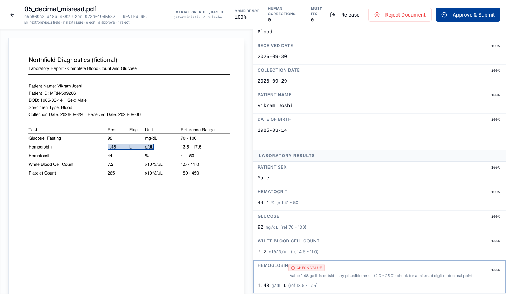
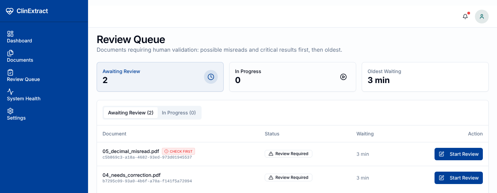
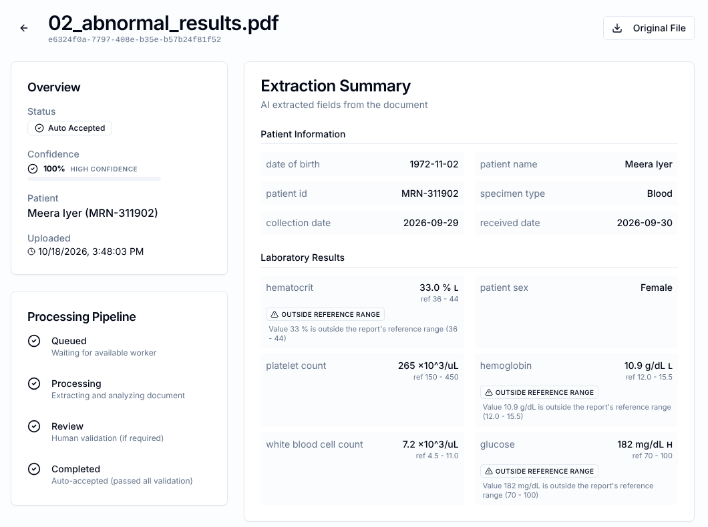
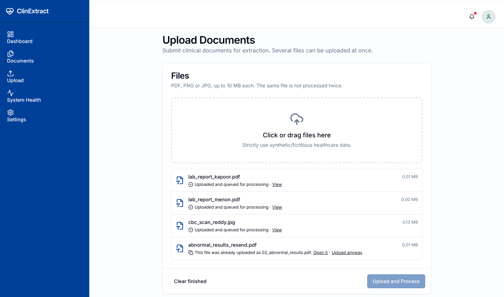
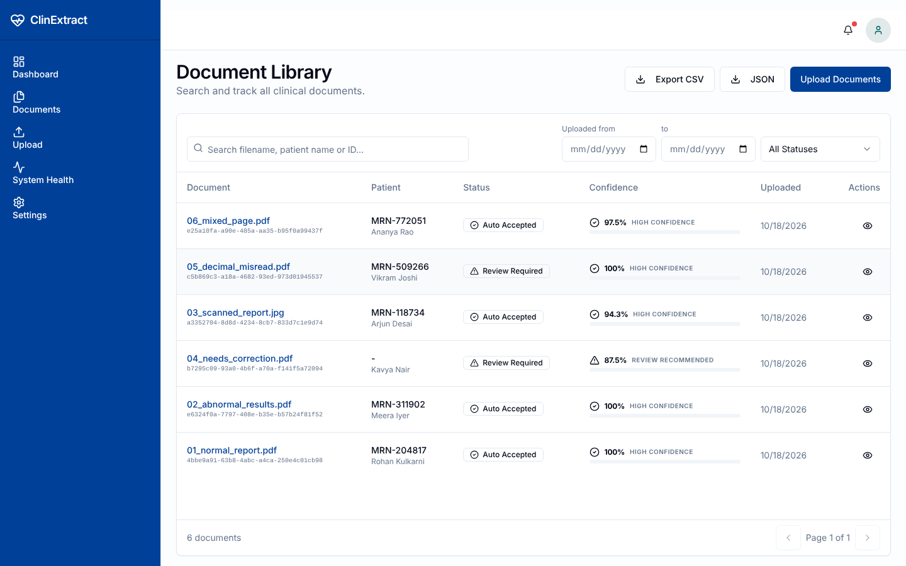
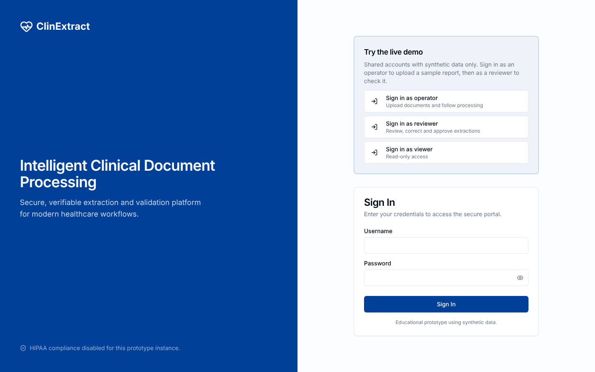
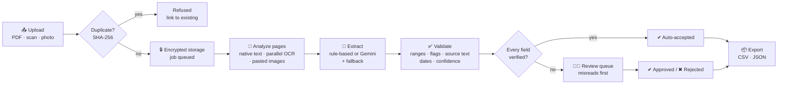
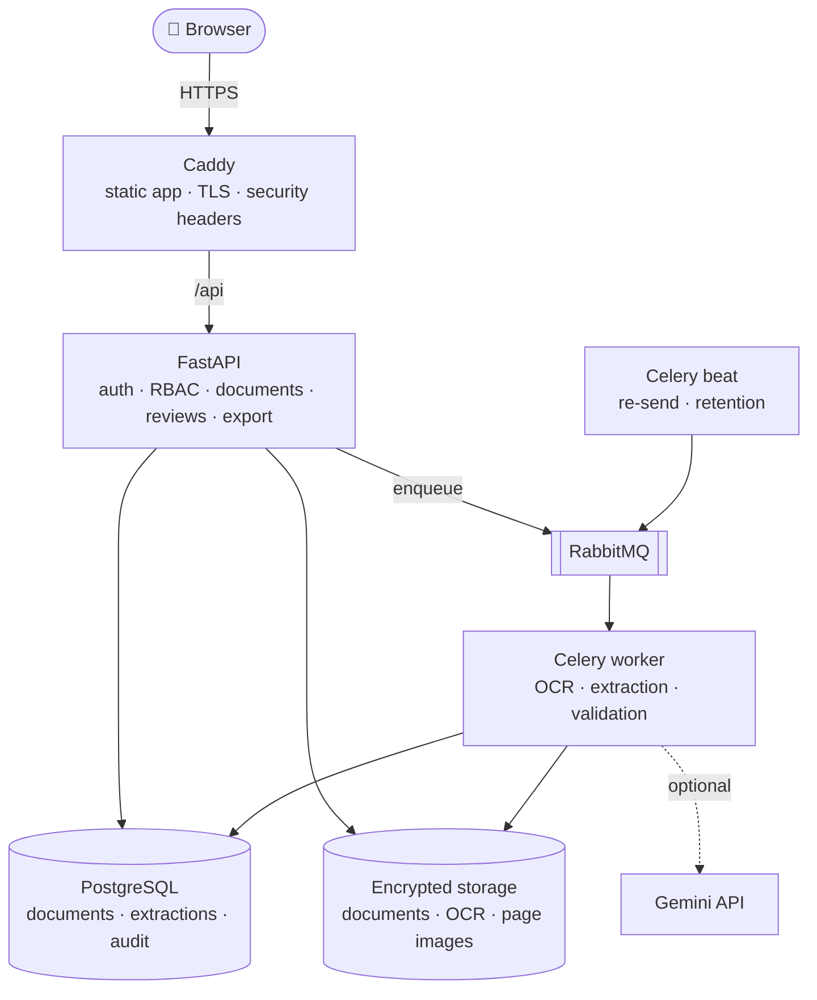

<div align="center">

# 🩺 ClinExtract

### Clinical lab reports in. Verified, structured data out.

ClinExtract reads lab reports (digital PDFs, scans and photos), extracts patient details and results,
checks every value against the document and against clinical reality, auto-accepts only what it can
stand behind, and sends everything else to a fast, keyboard-driven review screen with the evidence
highlighted on the page.

[](https://github.com/OmkarJayvantJadhav/ClinExtract/actions/workflows/ci.yml)


[**Features**](#-features) ·
[**How it works**](#-how-it-works) ·
[**Accuracy**](#-measured-accuracy) ·
[**Quick start**](#-quick-start) ·
[**Deploy for free**](#-deploy-for-free) ·
[**Configuration**](#%EF%B8%8F-configuration) ·
[**API**](#-api)

<br>



<sub><i>The review workspace: a misread hemoglobin value (1.48 instead of 14.8) is flagged, explained, and highlighted on the original report.</i></sub>

</div>

<br>

## ✨ At a glance

<table>
<tr>
<td align="center" width="25%"><h3>99%+</h3>fields extracted correctly<br><sub>on the synthetic evaluation sets</sub></td>
<td align="center" width="25%"><h3>100%</h3>of auto-accepted documents<br>fully correct</td>
<td align="center" width="25%"><h3>~70%</h3>of documents need<br>no human review</td>
<td align="center" width="25%"><h3>150+</h3>automated tests,<br>accuracy-gated CI</td>
</tr>
</table>

**Why it exists.** Lab results arrive as PDFs and scans. Typing them into a system by hand is slow and
error-prone; trusting OCR or an AI model blindly is unsafe. ClinExtract sits in between: it automates
the routine documents and hands a person exactly the ones, and exactly the fields, that need a human
eye, with the reason stated and the spot on the page highlighted.

<br>

## 🚀 Features

<table>
<tr>
<td width="50%" valign="top">

#### 📄 Reads real-world lab reports
- Digital PDFs, scanned PDFs, PNG and JPEG photos, multi-page documents
- **Mixed pages**: a typed header with the results pasted in as an image are both read
- Deskewing, 300 DPI OCR, and table-aware word ordering, so each test stays next to its result
- Pages OCR'd **in parallel**
- Label variants (`Hgb`, `HCT`, `WBC`, `PLT`, `GLU`, `MRN`, `D.O.B.`), units
  (mg/dL ↔ mmol/L, g/dL ↔ g/L, K/µL, 10⁹/L), and dates (ISO, US, `14-Mar-1985`)

</td>
<td width="50%" valign="top">

#### 🧠 Pluggable extraction engines
- **Rule-based** (default): deterministic, fast, nothing leaves your servers
- **Gemini LLM** over the OCR text, or **Gemini Vision** over the page images
- Automatic **fallback** to the rule-based engine if the AI provider fails
- External AI is refused unless explicitly allowed for patient data

</td>
</tr>
<tr>
<td width="50%" valign="top">

#### ✅ Validation that catches misreads
- Uses the **report's own reference range and H/L flag** when printed, built-in
  adult ranges (sex-specific) otherwise
- Flags **likely misreads**: impossible values, values 4× outside the range
  (a dropped decimal point), H/L flags that contradict the reading, OCR-garbled names
- Confirms every value is actually printed on the page, next to its label
- Cross-checks dates (birth ≤ collection ≤ received) and confidence

</td>
<td width="50%" valign="top">

#### 👩‍⚕️ Fast human review
- **Priority queue**: possible misreads and critical results first
- Side-by-side workspace with the field **highlighted on the original page**
- Keyboard-driven: <kbd>j</kbd>/<kbd>k</kbd> move · <kbd>n</kbd> next issue ·
  <kbd>e</kbd> edit · <kbd>a</kbd> approve · <kbd>r</kbd> reject
- Opens the **next document** automatically after each decision
- Corrections require a reason and are kept with the original value

</td>
</tr>
<tr>
<td width="50%" valign="top">

#### 📦 Data in and out
- **Batch upload** with real per-file progress
- **Duplicate detection** (SHA-256): the same file is never processed twice
- **CSV / JSON export** of reviewed results, normalized to canonical units,
  with flags and reference ranges, filtered like the library
- Failed documents can be **retried** without re-uploading

</td>
<td width="50%" valign="top">

#### 🔐 Security and compliance
- Role-based access (Admin, Operator, Reviewer, Viewer) on every endpoint
- Documents and OCR output **encrypted at rest**; every view, download and export audited
- Hardened sessions, lockout, shared rate limiting, CSRF protection
- Retention purge, redacted audit trail on deletion, nightly backups

</td>
</tr>
</table>

<br>

## 📸 Screenshots

<table>
<tr>
<td width="50%"><p align="center"><sub><b>Review queue</b>: possible misreads first</sub></p></td>
<td width="50%"><p align="center"><sub><b>Document page</b>: abnormal results flagged against the report's own ranges</sub></p></td>
</tr>
<tr>
<td width="50%"><p align="center"><sub><b>Batch upload</b>: progress per file, duplicates caught</sub></p></td>
<td width="50%"><p align="center"><sub><b>Library</b>: search, filters and CSV/JSON export</sub></p></td>
</tr>
</table>

<details>
<summary><b>Sign-in page with one-click demo accounts</b></summary>
<br>

</details>

<br>

## 🔬 How it works



A document is **auto-accepted only when every field is valid and read with high confidence**. Abnormal
results are clinical findings, not extraction errors: they are flagged on the record and in the export
but don't force a review on their own (an admin setting can change that). Everything that might be a
misread goes to a person.

<details>
<summary><b>Validation states</b>: what each flag means and what happens next</summary>
<br>

| State | Meaning | Outcome |
|---|---|---|
| `VALID` | Value parsed, plausible, found on the page | Auto-accept eligible |
| `OUTSIDE_REFERENCE_RANGE` | Abnormal result (H/L), report's range when printed | Flagged; review only if the admin policy asks |
| `EXTREME_VALUE` | Impossible, or more than 4× outside the range: usually a misplaced decimal point | Review, confirm or correct |
| `FLAG_MISMATCH` | The report's printed H/L flag disagrees with the value read | Review, confirm or correct |
| `POSSIBLE_MISREAD` | A scanned name with OCR tell-tales (`lyer` for `Iyer`, digits in names) | Review, confirm or correct |
| `SOURCE_MISMATCH` | The value does not appear on the page next to its label (guards AI output) | Review, confirm or correct |
| `NO_REFERENCE_RANGE` | A child's result with no printed range to compare against | Review, confirm or correct |
| `UNRECOGNIZED_UNIT` | A unit the converter doesn't know | Review, confirm or correct |
| `INCONSISTENT_DATES` | e.g. received before collected | Review, confirm or correct |
| `MISSING` · `INVALID_FORMAT` · `IMPLAUSIBLE_VALUE` | No value, unreadable value, or a date in the future | **Blocks approval** until corrected |

Lab results and patient identifiers (name, ID, date of birth) must also be read with high
confidence to be auto-accepted; on scans, that's where misreads hide.

</details>

<br>

## 📊 Measured accuracy

Accuracy is measured, not assumed. `backend/scripts/evaluate_extraction.py` generates labeled
synthetic lab reports that vary the **layout** (tables, `Label: value` lines, abbreviations),
**label wording**, **date formats**, **units**, **sex-specific ranges**, **H/L flags** and **media**
(digital PDFs, noisy rotated scans, typed headers with pasted result tables), runs them through the
real pipeline and scores every field.

| Evaluation set | Fields correct | Documents auto-accepted | Auto-accepted **and** fully correct |
|---|:---:|:---:|:---:|
| 60 reports · seed 0 | 99.3% | 70.0% | **100%** |
| 90 reports · seed 7 | 99.7% | 73.3% | **100%** |
| 60 reports · seed 21 | 98.9% | 68.3% | **100%** |

The remaining errors are OCR misreads on scans (a dropped decimal point, a wrong digit, `I`/`l` in a
name), and every one of them was caught and sent to review instead of being auto-accepted.
**CI fails** if accuracy drops or a wrong document would be auto-accepted.

```bash
cd backend
python scripts/evaluate_extraction.py --count 60 --failures            # rule-based engine
GEMINI_API_KEY=... python scripts/evaluate_extraction.py --extractor llm   # compare Gemini (synthetic data only)
```

> [!NOTE]
> These are synthetic documents. Measure on a sample of your own de-identified reports before relying
> on the numbers.

<br>

## ⚡ Quick start

**Prerequisites:** Docker with Docker Compose. Optional: a Google Gemini API key.

```bash
git clone https://github.com/OmkarJayvantJadhav/ClinExtract.git
cd ClinExtract
docker compose up -d --build
docker compose exec backend python scripts/seed_users.py
```

| Service | URL |
|---|---|
| Web app | http://localhost:5173 |
| API documentation (Swagger) | http://localhost:8001/api/v1/docs |
| RabbitMQ console | http://localhost:15672 |

Development accounts created by the seed script:

| Role | Username | Password |
|---|---|---|
| Admin | `admin` | `devpass_admin` |
| Operator | `operator` | `devpass_operator` |
| Reviewer | `reviewer` | `devpass_reviewer` |
| Viewer | `viewer` | `devpass_viewer` |

> [!WARNING]
> These passwords are for local development only. The seed script refuses them when
> `APP_ENV=production`; set the `*_SEED_PASSWORD` variables instead.

Migrations run automatically when the backend starts. If a port is taken, override it in `.env`
(`FRONTEND_HOST_PORT`, `BACKEND_HOST_PORT`, `DB_HOST_PORT`, `RABBITMQ_HOST_PORT`,
`RABBITMQ_UI_HOST_PORT`); CORS and the frontend's API URL follow automatically.

### 🧪 Try it with the sample reports

Six synthetic reports in [`frontend/public/samples`](frontend/public/samples) each demonstrate one behavior
(regenerate them with `backend/scripts/make_sample_reports.py`):

| Sample | What it shows | Outcome |
|---|---|---|
| `01_normal_report.pdf` | Clean digital report | ✔ Auto-accepted |
| `02_abnormal_results.pdf` | High glucose, low hemoglobin, with the report's own ranges | ✔ Auto-accepted, results flagged |
| `03_scanned_report.jpg` | Rotated, noisy scan | Deskewed and read with OCR |
| `04_needs_correction.pdf` | Missing patient ID, impossible birth date | 👩‍⚕️ Review: must be corrected |
| `05_decimal_misread.pdf` | Hemoglobin printed as 1.48 instead of 14.8 | 👩‍⚕️ Review: "Check value", checked first |
| `06_mixed_page.pdf` | Typed header, results pasted as an image | Both parts read |

<br>

## 🌍 Deploy for free

One command sets up the complete production stack on a single Ubuntu server, with HTTPS on a free
hostname, shared demo accounts with one-click sign-in, and the sample reports ready to download:

```bash
git clone https://github.com/OmkarJayvantJadhav/ClinExtract.git && cd ClinExtract
sudo bash scripts/setup-server.sh            # → https://<server-ip>.sslip.io
```

| Option | Server | Cost | Guide |
|---|---|---|---|
| **AWS** | t4g.small · 2 ARM CPUs · 2 GB | Free plan + T4g free trial | [docs/DEPLOY_AWS.md](docs/DEPLOY_AWS.md) |
| **Oracle Cloud** | Always Free Ampere A1 · 2 CPUs · 12 GB | Free, permanently | [docs/DEPLOY_FREE_ORACLE.md](docs/DEPLOY_FREE_ORACLE.md) |

The script installs Docker, opens the firewall, generates every secret, sizes the processes to the
machine, builds and starts the stack, and creates the accounts. Re-running it after `git pull` updates
in place and keeps your secrets and data.

<details>
<summary><b>Production stack, backups and monitoring</b></summary>
<br>

`docker-compose.prod.yml` exposes only the web server:

| Service | Role |
|---|---|
| `web` | Caddy: serves the built frontend, proxies `/api`, automatic HTTPS, HSTS/CSP headers |
| `backend` | FastAPI; runs migrations on start; health-checked via `/api/v1/health/ready` |
| `worker` | Celery document processing; health-checked with `celery inspect ping` |
| `beat` | Scheduler: stuck-job re-sending every 10 minutes, nightly retention purge |
| `db`, `rabbitmq` | Internal only, persistent volumes |
| `backup` | Daily database dump and encrypted document archive |

Manual setup (instead of the script):

```bash
cp .env.production.example .env.production   # fill in every value
docker compose -f docker-compose.prod.yml --env-file .env.production up -d --build
docker compose -f docker-compose.prod.yml --env-file .env.production exec backend python scripts/seed_users.py
```

The API refuses to start in production without a strong `JWT_SECRET` and a `DOCUMENT_ENCRYPTION_KEY`.

**Backups.** The `backup` service writes `db-<timestamp>.dump` and `files-<timestamp>.tar.gz` every
`BACKUP_INTERVAL_SECONDS` and keeps them for `BACKUP_RETENTION_DAYS`:

```bash
docker compose -f docker-compose.prod.yml --env-file .env.production run --rm backup --once
scripts/restore.sh 20261006T030000Z
```

Copy backups off the host to encrypted storage. Stored files stay encrypted inside the archive, so keep
`DOCUMENT_ENCRYPTION_KEY` safe: backups are unreadable without it.

**Monitoring.**
- `GET /api/v1/health` (liveness), `/health/ready` (database), `/health/detailed` (database, broker, worker, storage)
- `GET /api/v1/health/metrics`: Prometheus metrics (request rates and latency, documents and jobs by
  status, oldest pending review, dependency health). Requires `Authorization: Bearer $METRICS_TOKEN`
  and is blocked at the public web server; scrape `backend:8000` inside the Docker network.
- Suggested alerts: `clinextract_dependency_up == 0`, rising
  `clinextract_processing_jobs{status="FAILED"}`, `clinextract_oldest_pending_review_age_seconds` above your review SLA.

</details>

<br>

## ⚙️ Configuration

Settings are environment variables (a `.env` file next to `docker-compose.yml`, or
`.env.production` for the production stack).

| Variable | Default | Purpose |
|---|---|---|
| `EXTRACTION_PROVIDER` | `rule_based` | `rule_based`, `llm` (Gemini over OCR text) or `vlm` (Gemini Vision over page images) |
| `LLM_PROVIDER` / `VLM_PROVIDER` | – | `gemini` to use Google's models |
| `GEMINI_API_KEY` | – | Required for the Gemini engines |
| `ALLOW_EXTERNAL_AI_PHI` | `false` | Must be `true` before patient data may be sent to an external AI |
| `EXTRACTION_FALLBACK_ENABLED` | `false` | Fall back to the rule-based engine if the AI engine fails |
| `DATE_ORDER` | `MDY` | How to read 03/04/2025: `MDY` (March 4) or `DMY` (3 April) |
| `OCR_WORKERS` | CPUs, max 4 | Pages of one document OCR'd in parallel |
| `API_WORKERS` / `WORKER_CONCURRENCY` | `2` / `2` | API processes and concurrent documents (production) |
| `STUCK_JOB_MINUTES` | `15` | Re-send a queued job idle this long |
| `DOCUMENT_RETENTION_DAYS` | `0` (off) | Purge finished documents after this many days |
| `DOCUMENT_ENCRYPTION_KEY` | – | Fernet key for encryption at rest (required in production) |
| `JWT_SECRET` | – | Session signing secret (required in production) |
| `LOGIN_MAX_FAILED_ATTEMPTS` / `LOGIN_LOCKOUT_MINUTES` | `5` / `15` | Account lockout |
| `LOGIN_RATE_LIMIT_PER_MINUTE` | `20` | Login attempts per client IP, shared by all API processes |
| `DEMO_ACCOUNTS` / `DEMO_PASSWORD` | off | Shared one-click demo accounts on the sign-in page |

Confidence thresholds and the review policy (whether abnormal results are held for review) are
changed at runtime by an admin in **Settings**.

> [!IMPORTANT]
> The Gemini engines send document content to Google. Enable `ALLOW_EXTERNAL_AI_PHI` only under an
> appropriate data-processing agreement (e.g. a HIPAA BAA) for your deployment.

<br>

## 🏗️ Architecture



<table>
<tr>
<td valign="top" width="33%">

**Backend**
- Python 3.11, FastAPI
- SQLAlchemy 2.1 (async), Alembic
- Celery 5 + RabbitMQ
- PyMuPDF, Tesseract, OpenCV
- Google GenAI SDK (optional)

</td>
<td valign="top" width="33%">

**Frontend**
- React 19, Vite
- TanStack Query
- Tailwind CSS 4, Radix UI (shadcn)
- Vitest + Testing Library

</td>
<td valign="top" width="33%">

**Platform**
- PostgreSQL 15
- Docker Compose, Caddy
- GitHub Actions CI
- Prometheus metrics

</td>
</tr>
</table>

<details>
<summary><b>Project structure</b></summary>
<br>

```
ClinExtract/
├── backend/
│   ├── alembic/              # Database migrations
│   ├── evaluation/           # Labeled synthetic reports + accuracy scoring
│   ├── scripts/              # Seeding, sample reports, accuracy evaluation
│   ├── src/
│   │   ├── api/              # Route handlers (auth, documents, reviews, export, ...)
│   │   ├── core/             # Settings, database, logging, metrics, rate limiting
│   │   ├── db/models/        # SQLAlchemy models
│   │   ├── extraction/       # Rule-based, LLM and VLM engines, provider factory
│   │   ├── processing/       # Native text, OCR, mixed pages, page images
│   │   ├── services/         # Audit, retention, runtime settings
│   │   ├── storage/          # Encrypted file storage
│   │   ├── validation/       # Ranges, units, dates, misread checks, decision engine
│   │   └── worker/           # Celery app and tasks
│   └── tests/                # Pytest suite, regression fixtures, accuracy gate
├── frontend/
│   ├── public/samples/       # Synthetic sample reports
│   └── src/
│       ├── components/       # UI primitives (shadcn) and shared components
│       ├── features/review/  # Review workspace: viewer, fields, decision dialogs
│       ├── pages/            # Dashboard, library, upload, queue, settings, ...
│       └── services/         # API client
├── docs/                     # Guides, deployment, diagrams, screenshots
├── scripts/                  # Server setup, backup, restore
├── docker-compose.yml        # Development stack
└── docker-compose.prod.yml   # Production stack
```

</details>

<br>

## 🔌 API

Interactive documentation is served at `/api/v1/docs`. All endpoints are under `/api/v1`.

<details>
<summary><b>Endpoint overview</b></summary>
<br>

| Area | Method & path | Description |
|---|---|---|
| **Auth** | `POST /auth/login` · `POST /auth/logout` · `POST /auth/logout-all` | Cookie sessions, sign out everywhere |
| | `GET /auth/me` · `POST /auth/change-password` · `GET /auth/demo` | Current user, password change, public demo accounts |
| **Documents** | `POST /documents` | Upload (duplicate check; `?allow_duplicate=true` to override) |
| | `GET /documents` | Search, filter, sort (`newest`, `oldest`, `priority`), paginate |
| | `GET /documents/export?format=csv\|json` | Export reviewed results |
| | `GET /documents/{id}` · `DELETE /documents/{id}` | Details with extraction · permanent deletion (reason required) |
| | `GET /documents/{id}/file` · `/pages` · `/pages/{n}/image` | Original file, page count, page images |
| | `POST /documents/{id}/reprocess` | Retry a failed document |
| **Review** | `POST /reviews/{id}/claim` · `/release` · `/heartbeat` · `/complete` | Claim, release, keep alive, approve or reject with corrections |
| **Jobs** | `GET /jobs/{id}` | Processing job status |
| **Users** | `GET/POST /users` · `PATCH /users/{id}` | Manage accounts and roles |
| | `POST /users/{id}/reset-password` · `/unlock` · `/revoke-sessions` | Account administration |
| **Settings** | `GET /settings` · `PUT /settings/confidence-thresholds` · `PUT /settings/review-policy` | Runtime settings |
| **Insight** | `GET /analytics/metrics` · `GET /audit` | Operational metrics, audit trail |
| **Health** | `GET /health` · `/health/ready` · `/health/detailed` · `/health/metrics` | Liveness, readiness, dependencies, Prometheus |

</details>

### 👥 Roles

| | Admin | Operator | Reviewer | Viewer |
|---|:---:|:---:|:---:|:---:|
| View documents and their history | ✅ | ✅ | ✅ | ✅ |
| Upload, retry failed documents, export | ✅ | ✅ | | |
| Review, correct, approve, reject | ✅ | | ✅ | |
| Delete documents, manage users and settings, full audit log, analytics | ✅ | | | |

<br>

## 🛡️ Security and data protection

- **Sessions**: HttpOnly, SameSite=Strict JWT cookies (Secure in production) with double-submit CSRF
  tokens. A password or role change, deactivation, or "sign out everywhere" revokes sessions at once.
- **Brute force**: account lockout after repeated failures, and per-IP login rate limiting shared by
  all API processes. Failed logins and lockouts are audited.
- **Passwords**: Argon2 hashing; at least 12 characters mixing three character classes.
- **Uploads**: magic-byte type checks, streamed 10 MB limit, page and pixel limits.
- **Encryption at rest**: documents, OCR output and page images encrypted with Fernet (AES + HMAC).
- **Access logging**: every view, download and export is recorded in the audit log.
- **Deletion and retention**: permanent deletion with a required reason, keeping a redacted audit
  trail; optional automatic purge of finished documents.
- **Transport**: HTTPS via Caddy with HSTS, CSP, frame and content-type protections.
- **External AI**: refused for patient data unless explicitly allowed.

> [!CAUTION]
> These controls support, but do not by themselves constitute, HIPAA or GDPR compliance, which also
> requires organizational measures such as agreements, policies and risk assessment.

<br>

## 🧰 Development and testing

```bash
# Backend tests (use a separate database to keep test data out of development)
docker compose exec db createdb -U postgres clinextract_test
docker compose exec -e TEST_DATABASE_URL=postgresql+psycopg://postgres:postgres@db:5432/clinextract_test backend pytest

# Frontend
cd frontend && npm ci && npm run lint && npm test && npm run build
```

Running the backend without Docker:

```bash
cd backend
python -m venv .venv
.venv/bin/python -m pip install -r requirements.txt      # Windows: .venv\Scripts\python
```

**Continuous integration** (`.github/workflows/ci.yml`) runs on every push and pull request:
backend tests against PostgreSQL, including the accuracy gate; migrations applied to an empty database,
checked against the models and rolled back; frontend lint, tests and build; and Docker image builds.
The Gemini integration is tested against a fake SDK client, so no API key is needed.

<br>

## 📚 Documentation

| Guide | |
|---|---|
| [Deploy on AWS](docs/DEPLOY_AWS.md) | Free plan, step by step |
| [Deploy on Oracle Cloud](docs/DEPLOY_FREE_ORACLE.md) | Always Free, step by step |
| [Technical documentation](docs/ClinExtract_Technical_Documentation.md) | Components and data flow |
| [Architecture decisions](docs/ClinExtract_Architecture_Decisions.md) | Why the system is built this way |
| [Database deep dive](docs/ClinExtract_Database_Deep_Dive.md) | Schema and relationships |
| [API reference](docs/ClinExtract_API_Reference.md) | Endpoints in detail |
| [Troubleshooting](docs/ClinExtract_Troubleshooting_Handbook.md) | Common problems and fixes |
| [Diagrams](docs/diagrams) | Mermaid sources for flows and the data model |

<br>

## 📌 Project status

ClinExtract includes the technical controls expected of a production clinical-document system:
encryption, access logging, retention, hardened authentication, HTTPS deployment, backups,
monitoring and CI with an accuracy gate.

> [!IMPORTANT]
> It has not been certified, clinically validated or audited for HIPAA/GDPR compliance. Validate it
> against your own requirements and documents before any clinical use, and use only synthetic or
> properly de-identified data in demos.

<div align="center">
<br>
<sub>Built with FastAPI, React, PostgreSQL, Celery and Tesseract.</sub>
</div>
